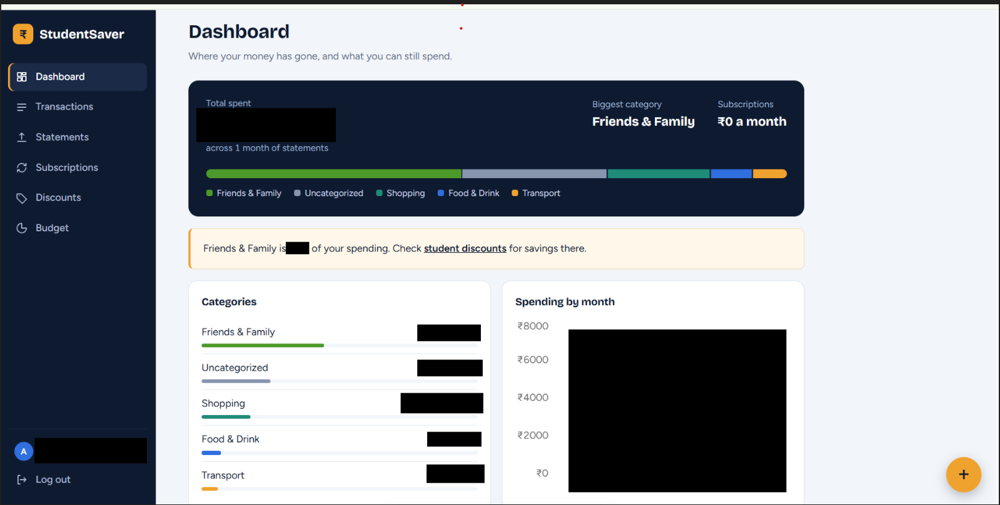
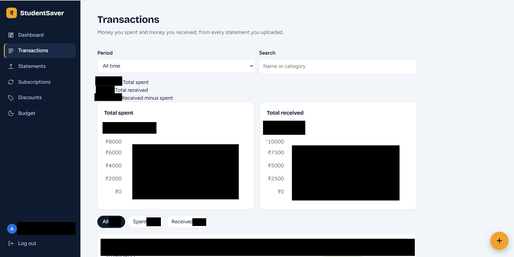

# StudentSaver

A serverless web app on AWS that helps college students see where their money goes. Upload a bank or UPI statement and StudentSaver sorts the payments into categories, finds recurring subscriptions, shows what you spent and received, and helps you stay inside a monthly budget and a daily limit.
 
**Region:** Asia Pacific (Mumbai), `ap-south-1`




---

## Why this project

Most finance apps are made for people with a steady salary and a paid link to their bank. Students have small, frequent UPI payments, irregular income, subscriptions they forget, and student discounts they never hear about. StudentSaver is built around that, runs on AWS free-tier services, and needs no bank integration: students bring their own statements.

---

## Features

**Getting data in**
- Upload CSV files or PDF statements, several files at once. A file can cover many months.
- Reads Google Pay and PhonePe-style statements and bank statement tables. For bank tables it works out debit or credit from the running balance, and saves nothing if the balances do not add up.
- Opens password-protected PDFs. The password is used once and never stored.
- Quick-add an expense by hand, or paste a bank or UPI SMS and check the details before saving.
- Pick a contact from your phone when adding a payment (Chrome on Android only).

**Understanding your money**
- Categories that learn: change a payee's category once and every past and future payment to that payee follows.
- Transactions page with separate Spent and Received lists, totals, two charts (total spent and total received, by month or by day), a period filter and search.
- Dashboard with a category share bar, monthly spending chart and per-category budget bars.
- Subscription detection from timing and amount patterns, with a month-by-month view that shows months a subscription was skipped.
- Directory of student discounts.

**Planning**
- Monthly budget per category.
- A "Today" card showing what is left to spend today, from either your own daily limit or your monthly budget divided by the days left.
- Email alerts when a category reaches 80% of its budget or goes over, and a weekly summary email.

**Your data**
- Delete a single statement, a whole month, or everything (transactions, subscriptions, learned categories and uploaded files).

---

## Architecture

```
Browser (React)
   |-- CloudFront + S3 (website files, HTTPS)
   |-- Cognito (sign-up, login, tokens)
   '-- API Gateway (Cognito authorizer on every route)
          '-- Lambda functions (Python)
                 |-- DynamoDB (all app data)
                 '-- S3 uploads bucket (private)  --event-->  Lambda (parse)

EventBridge Scheduler --> Lambda --> SNS --> student's email
```

**AWS services and what each does**
- **Cognito:** accounts, email confirmation, login tokens.
- **API Gateway:** REST API; rejects requests without a valid login token.
- **Lambda:** all backend logic. A Lambda layer holds the PDF library (pypdf with pycryptodome for encrypted files).
- **DynamoDB:** on-demand tables, all keyed by the student's user ID.
- **S3:** one private bucket for uploads (temporary presigned upload links) and one bucket for the website.
- **CloudFront:** serves the website over HTTPS.
- **SNS:** alert and summary emails, with a filter so each student only receives their own.
- **EventBridge Scheduler:** weekly alert check and weekly summary.
- **IAM and CloudWatch:** permissions and logs.

No EC2 instances are used. Everything is serverless and pay-per-use.

---

## Data model (DynamoDB)

- `Transactions`: `userId` + `transactionId`; date, amount (negative = spent), merchant, category, source file.
- `Subscriptions`: `userId` + `merchant`; amount, frequency, last and next charge, number of charges.
- `Budgets`: `userId` + `month`; category budgets. A row with month `settings` holds the daily limit.
- `CategoryRules`: `userId` + `payee`; the category the student chose.
- `Discounts`: `discountId`; store, category, details, link, how to verify.

Transaction IDs are derived from the user, date, payee and amount, so uploading the same statement twice does not create duplicates.

---

## API

All routes need a login token in the `Authorization` header.

- `GET /upload-link`: temporary upload address for a file
- `POST /process-statement`: read an uploaded file (with the PDF password if it has one)
- `GET /transactions`
- `GET /summary`
- `GET /subscriptions`
- `GET /discounts`
- `GET /budget`, `POST /budget`
- `POST /categorize`
- `POST /add-transaction`
- `POST /delete-data`
- `POST /alerts`: turn on email alerts

---

## How the main parts work

**Reading statements.** Each file's type is detected from its contents, not its name. CSV files need the columns `date,description,amount`. PDFs are tried as Google Pay or PhonePe-style rows first, then as a bank statement table.

**Subscriptions.** Payments are grouped by payee. Charges within 10% of the usual amount, spread over at least two months, at a steady monthly (about 26 to 35 days) or weekly rhythm, count as a subscription. Amounts under Rs 10 are ignored.

**Categories.** The student's own choices come first, then a small keyword list. This is rule-based. There is no machine learning.

**Budget and daily limit.** The daily figure is either the student's own limit, or the budget left divided by the days left in the month.

---

## Tech stack

React with Vite, React Router, Recharts, axios, and the Amazon Cognito identity library on the frontend. Python Lambdas on the backend, using boto3 and pypdf.

---

## Project structure

```
studentsaver/
  frontend/studentsaver-web/
    src/
      App.jsx          pages and components
      auth.js          Cognito sign-up, login, session
      api.js           calls to the API
      config.js        user pool, app client and API address
      smsParser.js     reads bank and UPI SMS text
      subHistory.js    month-by-month subscriptions
      dailyLimit.js    "left today" calculation
      flows.js         spent and received totals for the charts
      index.css        styles
  backend/             copy of each Lambda function's code
```

---

## Set it up yourself

1. **AWS account.** Create an IAM user (do not use the root account for daily work) and set a billing alarm. Install the AWS CLI and Node.js.
2. **Cognito.** Create a user pool with email sign-in and an app client without a secret.
3. **DynamoDB.** Create the five tables above in on-demand mode.
4. **S3.** Create a private uploads bucket (with CORS for PUT and GET) and a website bucket. Add an event notification on the uploads bucket that triggers the parse Lambda.
5. **Lambda.** Create one function per file in `backend/`, with the permissions each needs. Attach the PDF layer to the parse function and give it the uploads bucket name as `UPLOAD_BUCKET`. Give the alert functions the SNS topic address as `TOPIC_ARN`.
6. **API Gateway.** Create the REST API, add a Cognito authorizer, add the routes above with Lambda proxy integration, enable CORS on each, and deploy to a stage.
7. **SNS and EventBridge.** Create the topic and the weekly schedules.
8. **Frontend.** Put your own values in `src/config.js`, then build and publish:
```bash
cd frontend/studentsaver-web
npm install
npm run build
aws s3 sync dist/ s3://<your-website-bucket> --delete
aws cloudfront create-invalidation --distribution-id <your-id> --paths "/*"
```
9. **CloudFront.** Create a distribution for the website bucket with `index.html` as the default root object.

Never commit AWS access keys. The Cognito pool ID and app client ID are identifiers, not secrets, but it is still tidier to keep your own values out of a public repository.

---

## Cost

At about 50 students the project is designed to stay within AWS free-tier allowances: Lambda, API Gateway, DynamoDB, S3, Cognito and SNS usage is tiny, and CloudFront is on its Free plan. Check the Billing page regularly. Sending more than 1,000 emails a month would exceed SNS's free email allowance.

---

## Security and privacy

**In place**
- Every API route sits behind a Cognito login check.
- Each student can only read and change their own rows; the user ID comes from the verified token.
- The uploads bucket is private. Uploads use short-lived links limited to the student's own folder.
- The website is served over HTTPS.
- PDF passwords are used in memory only.
- Students can delete statements, months or all their data.

**Not done yet (planned hardening)**
- Sign-up is open to anyone with the link. It should be limited to college email addresses.
- Uploaded files stay in S3 until deleted. An automatic rule should remove them after a day or two.
- The API has no rate limit set.
- Lambda permissions use broad AWS-managed policies and should be narrowed.
- No multi-factor login.

Do not commit real bank or UPI statements to this repository. Use made-up sample data for demos and screenshots.

---

## Known limitations

- It works from uploaded statements, not a live bank feed, so it is not real time.
- PDF layouts differ between banks. Google Pay, PhonePe-style rows and common bank tables are handled; other layouts may report "no transactions found".
- Names come as printed on the statement, and banks often shorten them.
- Uploading a bank statement and a Google Pay statement for the same dates counts the same payments twice. Transfers between your own accounts count as spending and receiving.
- Subscription detection needs at least two charges in two different months, and can mistake regular payments to a person for a subscription.
- Contact picking works only in Chrome on Android.
- Alerts are emails only. There are no phone notifications.
- Some pages read all of a student's transactions at once, which suits a student-sized history.

---

## Testing

The statement readers, subscription rules, category learning, budget and delete logic were tested with sample statements and simulated AWS tables, and the pages were checked in a simulated browser. There is no automated test suite in this repository yet, and it has not been tried at scale with real classmates.

---

## Future work

- Split expenses with friends, with a "who owes whom" summary.
- More statement formats, and ZIP uploads.
- A "not a subscription" button.
- Alerts when the daily limit is passed.
- The security steps listed above.
- Infrastructure as code (Terraform or CDK) so the whole setup can be rebuilt automatically.

---

## Author

Built by Arundhoti as a cloud architecture design project at VIT Chennai.
